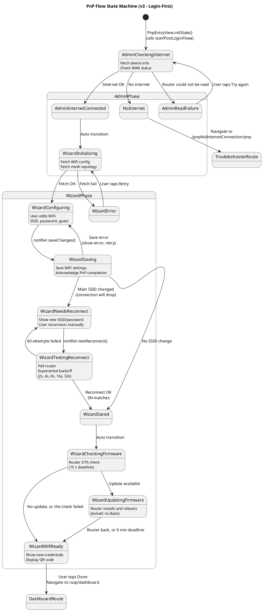
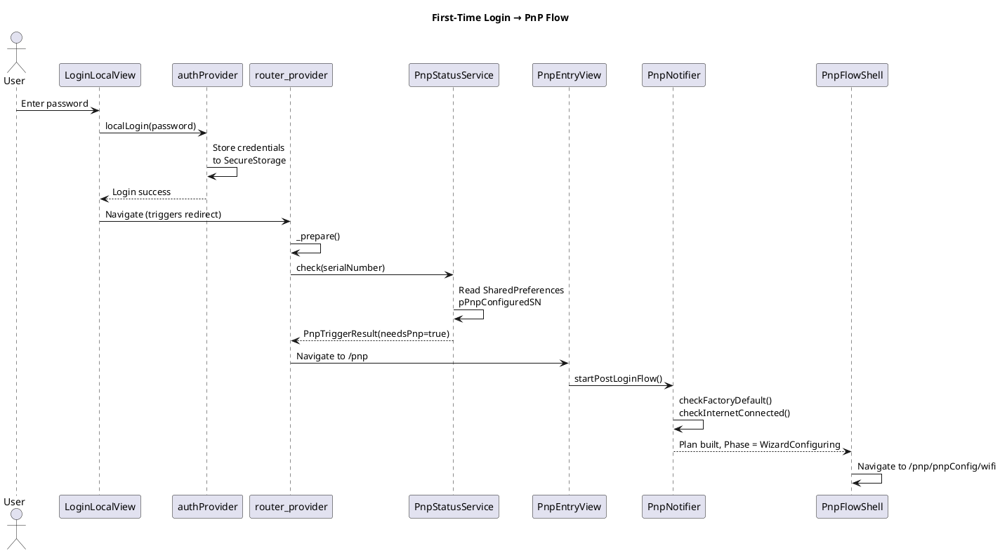

# PnP (Plug and Play) Flow State Machine Document

This document describes the PnP process state machine. Updated for v3 Login-First Architecture (2026-05).

## Change Log

### v3 (2026-05) — Login-First Architecture
- Removed: `AdminInitializing`, `AdminUnconfigured`, `AdminAwaitingPassword`, `AdminLoggingIn`, `AdminLoginFailed`
- Entry point changed: Login Page → `AdminCheckingInternet` (user already authenticated)
- PnP trigger: `router_provider._prepare()` calls `PnpStatusService.check()` after login

---

## Current State Diagram (v3)

The PnP flow is now a **post-login** state machine. User authentication is handled by `LoginLocalView` before entering PnP.



---

## Phase Definitions

### AdminPhase (PnpEntryView)

| Phase | Description | Triggers |
|-------|-------------|----------|
| `AdminCheckingInternet` | Entry point. Fetch device info, check WAN status. | `startPostLoginFlow()` |
| `AdminInternetConnected` | WAN up with valid IP. Ready for wizard. | Internet check success |
| `AdminReadFailure` | The router could not be read (device info or WAN), so its internet state is unknown. Shows its own card with Try again. | A read that throws in `startPostLoginFlow()` |
| `NoInternet` | WAN down or no IP. Route to troubleshooter. | Internet check failed |

### WizardPhase (the steps, and the frame's status screens)

| Phase | Description | Triggers |
|-------|-------------|----------|
| `WizardInitializing` | Fetching WiFi SSIDs, APs, mesh topology. | Enter from `AdminInternetConnected` |
| `WizardConfiguring` | User on the steps. Carries only a failed save's `saveError`: the form is in the steps' drafts, the nodes on `PnpState.meshNodes`. | Fetch success |
| `WizardSaving` | Saving WiFi changes to router. | `saveChanges()` |
| `WizardSaved` | Save complete, no SSID change. | Save success (no reconnect needed) |
| `WizardNeedsReconnect` | Main WiFi SSID changed. Connection dropped. | Save success (SSID changed) |
| `WizardTestingReconnect` | Polling router after reconnect. | `testReconnect()` |
| `WizardCheckingFirmware` | The router's OTA check, bounded at 15 s; every outcome but "update available" finishes setup. | After save/reconnect complete |
| `WizardUpdatingFirmware` | The router is installing a newer firmware; the route refuses to be left. | The check found an update |
| `WizardWifiReady` | Setup complete. Show credentials + QR. | No FW update needed |
| `WizardError` | Recoverable error during wizard. | Exception in wizard operations |

### Who navigates

Since #1511 P2 the `/pnp` tree sits under one `ShellRoute` whose body,
`PnpFlowShell` (`lib/page/instant_setup/views/pnp_flow_shell.dart`), is the only
place a `PnpPhase` becomes a page: `pnpFlowDestination(previous, next)` opens the
wizard's first step when the flow gets its plan — once per flow — and hands
`NoInternet` to troubleshooting. The views render phases; none of them navigates
on one. Next and Back are user gestures, and go where the plan says.

### The steps, the plan and the drafts (#1511 P4)

```
ShellRoute  (PnpFlowShell → PnpFlowFrameView: top bar, stepper, status screens)
├── /pnp                              entry checks (PnpEntryView)
│   └── pnpConfig                     empty placeholder; onExit = the wizard's exit guard
│       ├── wifi                      PnpWifiStepView
│       ├── guest                     PnpGuestStepView (only if the router has a guest SSID)
│       └── network                   PnpYourNetworkStepView — holds Save until #1511 P5
│           └── pnpAddNodes           pushed onto the root navigator, over the shell
```

- **The plan** (`PnpFlowPlan`, `PnpState.plan`) is built once, when the wizard
  reads the router, from the step list (`kPnpSettingSteps` and, for the page side,
  `pnpSettingStepPages`) and each step's inclusion condition. Nothing recomputes
  it; `startPostLoginFlow()` does nothing once there is one. The stepper's
  segments, Next/Back, which step holds Save, and the back policy all read it.
- **The drafts** — one `Preservable` notifier per setting step
  (`pnpMainWifiDraftProvider`, `pnpGuestWifiDraftProvider`) — hold what the user
  types. The flow begins each one at the router read and holds it, so a draft
  lives exactly as long as the flow. Edits never change `PnpState`. Save writes
  both in one SET (`PnpWifiWrite`), and marks them saved once the write has landed.
- **The current step is the URL.** A failed save returns to `WizardConfiguring`
  with no navigation, so the user is on the step where Save was pressed.
- **Status screens have no URL.** Saving, reconnect, the firmware stage, the
  completion screen and a wizard that could not start are drawn by the frame over
  the step, which stays mounted underneath.

### Back, and leaving the wizard (#1511 P4)

The shell's `redirect` is the back policy, `pnpBackPolicy(flow, target)`:

| flow | the entry | a step in the plan | anything else in the wizard |
|---|---|---|---|
| no plan yet | open | → the entry | → the entry |
| editing | open (the exit guard asks to log out) | open | → the first step |
| past editing | → the save step | → the save step, unless it is it | → the save step |

`pnpConfig`'s `onExit` decides by phase: the firmware stage and an in-flight save
(`WizardSaving`, `WizardSaved`, `WizardTestingReconnect`) refuse; **editing asks
whether to log out** — Back from the first step lands here — and on "Log out"
reverts the drafts, signs out and goes to the login page; anything else leaves,
with the drafts' dirty guard asking only if something is still unsaved.

### How long the flow lives

Since #1511 P3 `pnpProvider` is `autoDispose`, and `PnpFlowShell`'s subscription
is what holds it: the flow lives exactly while the user is in the `/pnp` tree.
Leaving it ends the flow — for the dashboard after the completion screen, or for
troubleshooting before the wizard — and the next visit starts a new one at
`AdminCheckingInternet`; nothing has to `invalidate` it. The firmware stage's
reboot does not end it, because the wizard is locked while the stage runs, so
the shell stays on screen. `PnpNotifier.build()` must stay side-effect free:
the flow is started by the entry (`startPostLoginFlow()`), never by being read.

### Troubleshooting phases (`TroubleshootingPhase`, not `PnpPhase`)

Since #1511 P1 the no-internet troubleshooting flow is a sub-flow with state of
its own — `internetTroubleshootingProvider` (`autoDispose`), in
`lib/page/instant_setup/providers/internet_troubleshooting_provider.dart` — and
none of its pages reads `pnpProvider`. PnP's part ends at `NoInternet`, which hands
the user to `/pnpNoInternetConnection/pnp`.

| Phase | Description |
|-------|-------------|
| `TroubleshootingNoInternet` | The hub and its forms; carries a failed ISP save's message once |
| `ModemRestartCountdown` | 150s countdown while modem reboots |
| `ModemRestartCheckingInternet` | Polling internet after modem restart (30 attempts) |
| `IspSaving` | Saving ISP settings with progress steps |
| `TroubleshootingRecovered` | Internet is back — the caller's ending takes over |
| `TroubleshootingReadFailure` | The router could not be read — the caller's ending takes over |

**The caller is in the URL** (`/pnpNoInternetConnection/:caller/…`), and the route
layer turns it into a `TroubleshootingEnding`: where a finished run goes, and
whether the hub offers "Log into router". PnP's (`pnp`) goes back to `/pnp`, whose
entry re-runs its check, and offers "Log into router" (acknowledge, then the
dashboard). The dashboard's (`dashboard`) goes back to the dashboard and offers no
bypass; no dashboard entry ships yet. The hub, which sits under every other page
of the tree, is the only page that hands a finished run over.

---

## Removed Phases (v3)

The following phases were removed in v3 Login-First Architecture:

| Phase | Reason |
|-------|--------|
| `AdminInitializing` | Login now handled by `LoginLocalView` |
| `AdminUnconfigured` | Factory default detection removed (all routers have automaster) |
| `AdminAwaitingPassword` | Password input moved to `LoginLocalView` |
| `AdminLoggingIn` | Login logic moved to `authProvider` |
| `AdminLoginFailed` | Login error handling moved to `LoginLocalView` |

---

## Sequence Diagram: First-Time Login → PnP



---

## Legacy State Diagram (Pre-v3)

For historical reference, the pre-v3 state diagrams are preserved in git history. Key differences:

1. **Pre-v3**: `PnpAdminView` handled both login and internet check
2. **v3**: Login separated to `LoginLocalView`, `PnpEntryView` only checks internet
3. **Pre-v3**: Factory default detection via `checkRouterConfigured()`
4. **v3**: All routers treated as configured (automaster), PnP trigger via `PnpStatusService`
